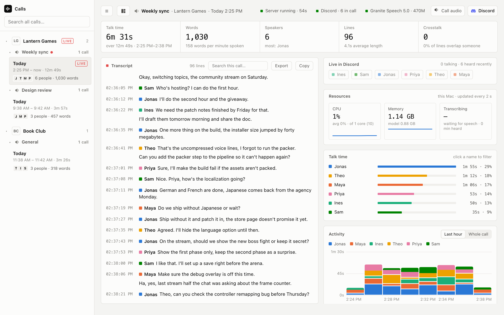
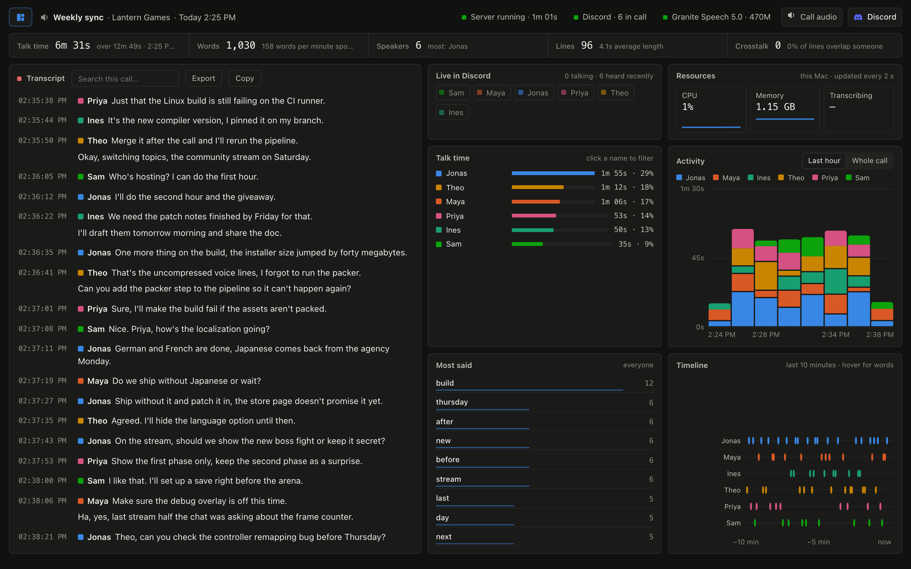
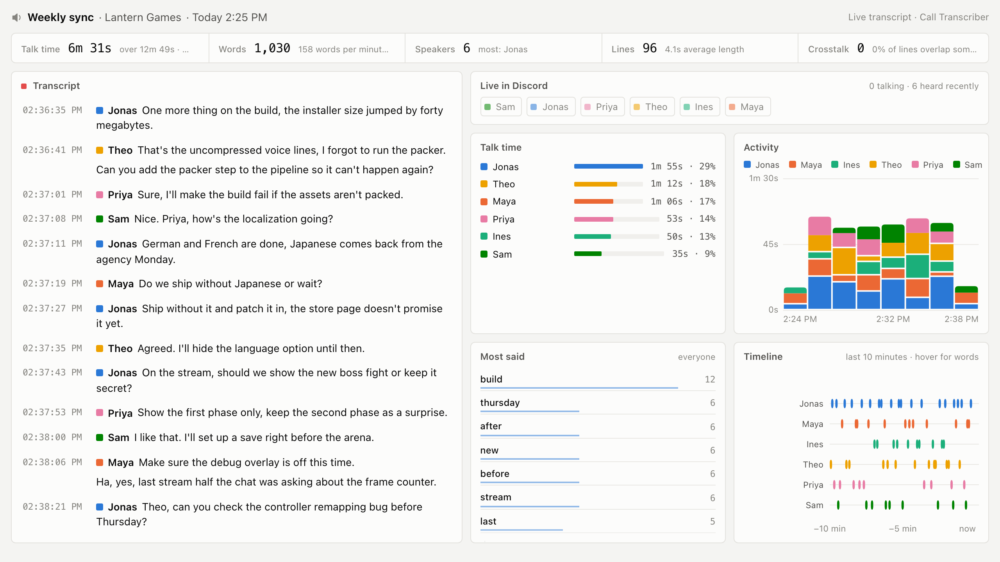

# Call Transcriber

Live, local transcripts of Discord voice calls, one person at a time.

Call Transcriber is a desktop app for macOS and Windows with Discord built in.
Join a voice channel in its Discord window, and every participant is transcribed
from their own audio stream. Overlapping speech stays separate and every line is
labelled with the right name. Transcripts, history and analytics live in a
dashboard next to the call. Audio never leaves your computer.


<sub>Demo data. Names and conversation are fictional.</sub>

## What it does

- **One stream per person.** Discord delivers each participant as a separate
  audio stream. The app reads those streams directly, so there is no speaker
  guessing and crosstalk doesn't get merged.
- **Discord built in.** The app opens discord.com in its own window with your
  normal account, so Chrome and extensions aren't needed. Closing the window
  keeps you in the call.
- **Dashboard.**
  - **Call view:** a live transcript with search and export (Markdown, text,
    SRT, CSV, JSON), who's in the call, talk time, activity over time, a
    10-minute timeline, crosstalk and most-said words.
  - **History:** past calls are grouped by server and voice channel, with
    search across all of them. Right-click to archive, export or delete.
- **Compact mode.** The transcript and every panel fit on one screen. Press
  ⌘⇧K / Ctrl+Shift+K.
- **Share it in the call.** Screen sharing from the built-in Discord opens a
  picker. It includes a clean compact view made for sharing that shows the live
  transcript and stats but none of your controls.
- **Mute call audio for yourself.** Silence the call on your end while it keeps
  being transcribed (⌘⇧M / Ctrl+Shift+M).
- **Choice of speech models.** All run locally and switch live:

  | Model | Words wrong* | Mac (Apple GPU) | Windows (NVIDIA GPU) | Notes |
  |---|---|---|---|---|
  | **Granite Speech 5.0 · 470M** (default) | 5.5% | 249× real time | 82× | best overall |
  | Granite Speech 5.0 · 2B | 5.4% | 13× | 11× | most accurate, 9 GB |
  | Parakeet TDT 0.6B v3 | 7.0% | 116× | 30× (CPU) | 25 European languages |
  | Qwen3-ASR · 1.7B | 8.5% | 18× | 10× | 52 languages |
  | Whisper large-v3-turbo | 13% | 15× | 30× | 99 languages |

  <sub>*Word error rate on 120 real meeting clips (AMI), measured on this project's machines.</sub>
- **Updates itself.** When a new release is out the dashboard says so, and
  **Update now** installs it.

| Compact mode | Shared view (what the call sees) |
|---|---|
|  |  |

## Install

### macOS (Apple Silicon)
Needs [uv](https://docs.astral.sh/uv/), Node.js and Xcode's command-line tools.
```bash
git clone https://github.com/Bruno-Alumn/call-transcriber.git ~/discord-transcriber
cd ~/discord-transcriber/server && uv sync
~/discord-transcriber/app/mac/build.sh
```
`build.sh` installs **Call Transcriber** in `~/Applications`. Open it, sign in to
Discord in its Discord window (⌘D) once, and join a voice channel. macOS asks
for the microphone the first time.

### Windows 10/11
```bash
git clone https://github.com/Bruno-Alumn/call-transcriber.git %USERPROFILE%\CallTranscriber
```
Then double-click **install.cmd** in that folder. It installs everything:
- Python and the transcription server.
- The NVIDIA GPU engine, if you have an NVIDIA card. Without one it uses a fast
  CPU engine.
- The speech model and the app (and Node.js if it's missing).
- Start-menu and desktop shortcuts.

See [README-WINDOWS.md](README-WINDOWS.md) for details.

Install with `git clone` as shown, rather than from the release zip, so the
in-app updates can work.

## Using it

1. Start **Call Transcriber**. It runs the transcription server and shows the
   dashboard.
2. Open the Discord window (the **Discord** button, or ⌘D / Ctrl+D) and join a
   voice channel. Transcription starts by itself.
3. Transcripts are saved as Markdown and JSON Lines, one file per day, in
   `transcripts/`.

Closing the windows keeps transcribing. Quit (⌘Q, or the Windows tray icon)
stops everything. The dashboard is also available at http://127.0.0.1:8765/.

Notes:
- Your own microphone isn't transcribed, only other people's.
- Don't use Discord's *Deafen*: it stops audio from arriving. Use **Mute call
  audio** instead.
- Someone whose name can't be read from Discord shows as `user-1234`, the last
  digits of their id.
- You're responsible for following the recording laws where you and the other
  participants are.

## How it works

```
Discord window (built-in Chromium)
  └─ page-hook.js, injected before Discord's own code
       reads each participant's WebRTC audio track
       (stream id "<userId>-<ssrc>"), 16 kHz chunks
  └─ app main process ──WebSocket──▶ local server (Python)
                                      ├─ per-person voice activity detection
                                      ├─ speech model (MLX / CUDA / ONNX)
                                      └─ transcripts/*.md + *.jsonl
dashboard ◀──HTTP + live updates── local server
```

| Part | Where |
|---|---|
| Desktop app (Electron): dashboard, Discord window, share picker, tray | `app/desktop/` |
| Transcription server and dashboard | `server/` |
| Hook that reads the per-person audio | `extension/page-hook.js` |
| Mac app bundle build | `app/mac/build.sh` |
| Windows installer | `install.cmd`, `install.ps1`, `app/windows/` |
| Optional Chrome extension (Discord in Chrome instead) | `extension/` |
| Tests | `test/` |

The server picks the speech engine for the machine: MLX on Apple Silicon, CUDA
with an NVIDIA GPU, otherwise ONNX Runtime on the CPU. Override it with
`--engine mlx|torch|onnx`.

## Development

- `node test/app-test.js <dir>` runs the real desktop app against a fake Discord
  call with four speakers. It checks:
  - that the hook is injected before Discord's code;
  - the capture rate while the window is hidden;
  - names, channels, mute and screen sharing;
  - that quitting stops the server.
- `cd server && uv run python ../test/server_e2e.py` runs the server end-to-end
  test with three overlapping speakers.
- CI runs both tests on macOS and Windows for every push. Pushing a tag `vX.Y.Z`
  (matching `VERSION`) publishes a release, and the apps offer it as an update.

Transcripts, learned names and archive choices are personal data and are never
committed (see `.gitignore`).
